# TDIU Clubs

Student-club ecosystem for Tashkent State University of Economics (TDIU), built for the
Yoshlar ittifoqi club network. One umbrella platform, and a full digital presence for every club:
public website, Telegram bot and Telegram Mini App.

Phase 1 ships the Book Club (`@tsuebookclub`) end to end. The other 21 clubs are present in the
directory and can be switched on one by one — the data model is multi-club from day one.

**Live:** https://tsue-clubs.onrender.com · **Bot:** https://t.me/Tsue_clubs_bot

## Preview

| Public portal — light | Public portal — dark |
| --- | --- |
| 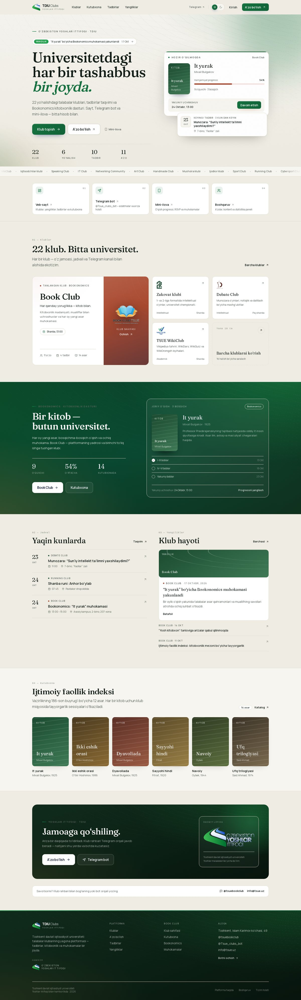 | 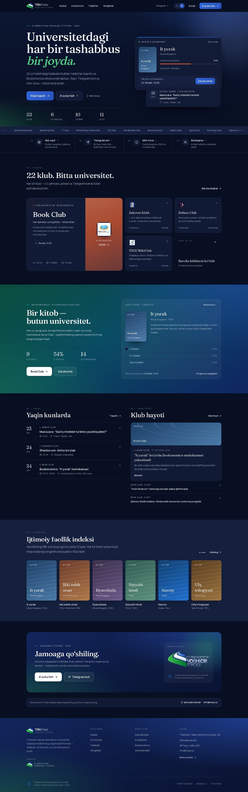 |

| Club page | Club directory |
| --- | --- |
| 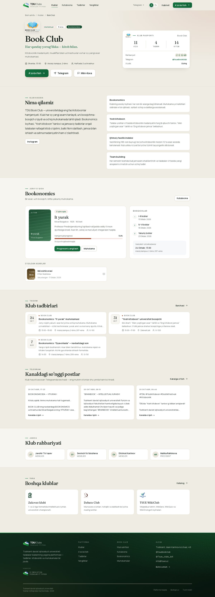 | 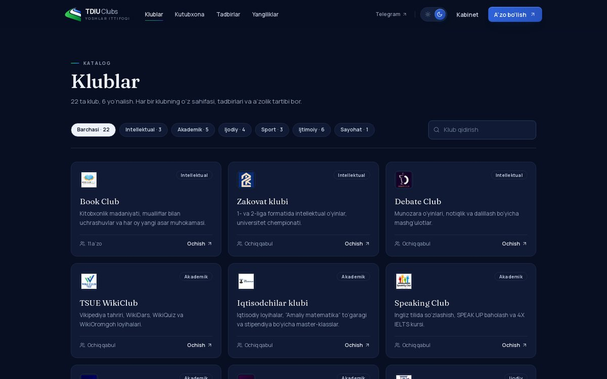 |

| Member Mini App | Admin console |
| --- | --- |
| 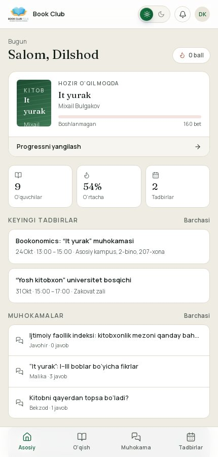 | 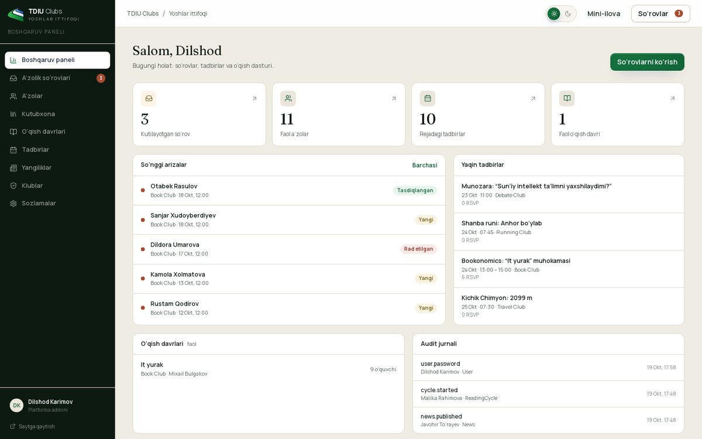 |

| Admin console — dark | Mobile portal |
| --- | --- |
| 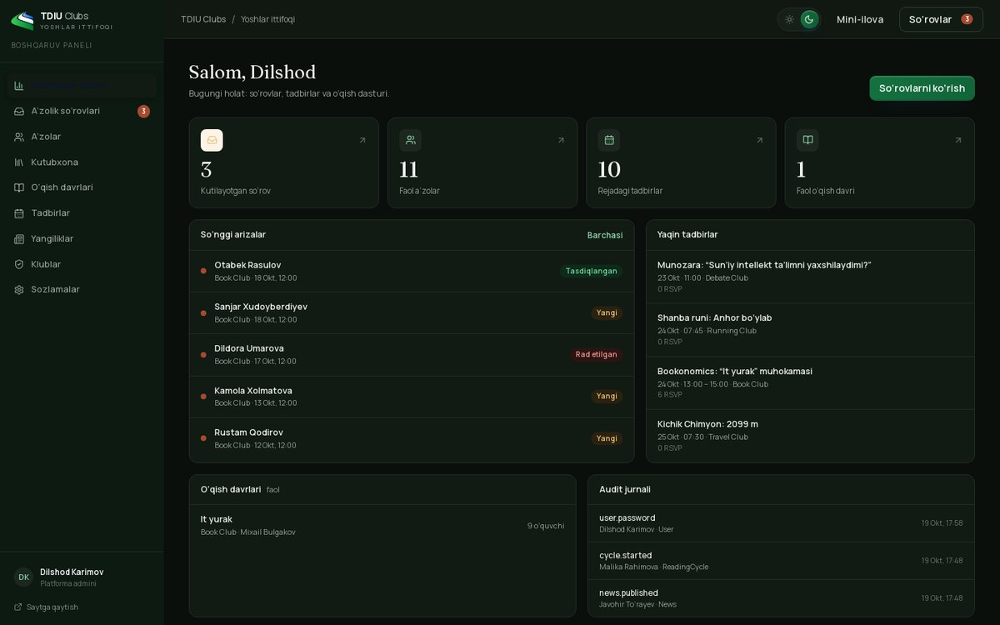 | 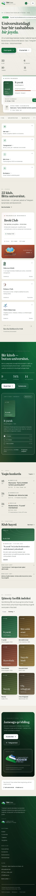 |

| Member Mini App — dark | Sign in |
| --- | --- |
| 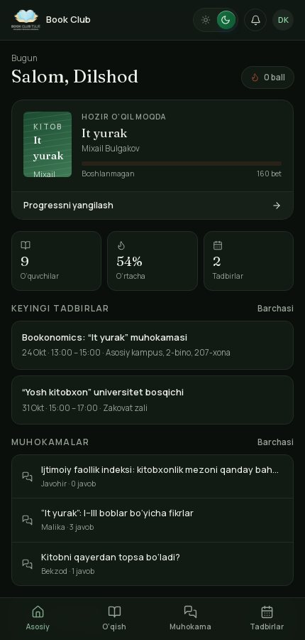 | 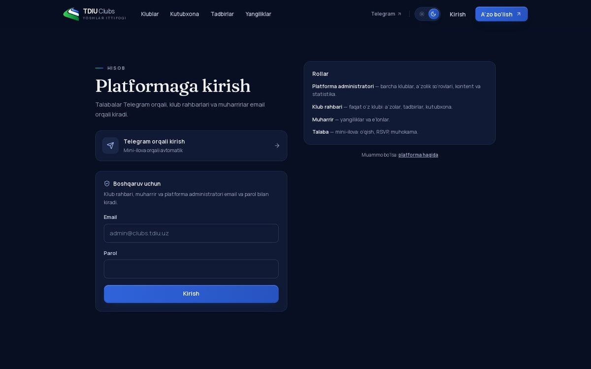 |

| Unified search — ⌘K palette | Saved pages (device-local) |
| --- | --- |
| 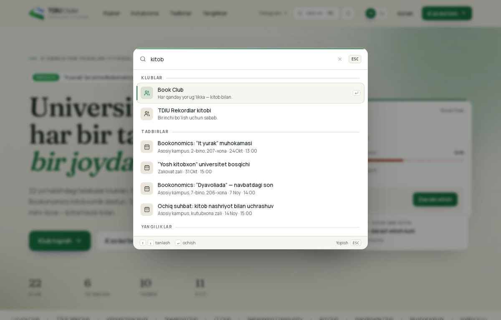 | 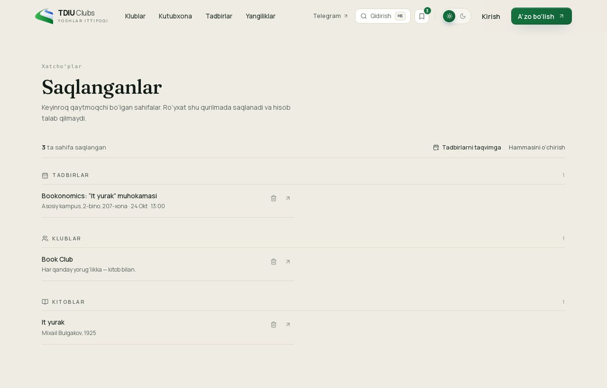 |

Each club keeps its own emblem, pulled from its Telegram channel and served locally
(`public/clubs/<slug>.jpg`), so the directory reads as the real club network rather than a
placeholder grid.

## What is inside

| Surface | Route | Purpose |
| --- | --- | --- |
| Public portal | `/` | Club directory, shared news, cross-club events, reading programme |
| Club pages | `/clubs/[slug]` | Per-club identity: passport, projects, team, events, current cycle |
| Library | `/books`, `/books/[id]` | Bookonomics and Ijtimoiy faollik indeksi reading list |
| Events | `/events`, `/events/[id]` | Calendar with RSVP (works for every club) |
| News | `/news`, `/news/[slug]` | General and club news |
| Join | `/join?club=slug` | Membership application, routed to the club lead |
| Member Mini App | `/app` | Reading progress, discussions, RSVP, profile — Telegram-first |
| Admin console | `/admin` | Requests, members, library, reading cycles, events, news, settings |
| Search | `/qidiruv?q=` | One field across clubs, library, events and news; ⌘K palette everywhere |
| Help | `/yordam` | Short guide: joining, calendar, search, bookmarks, admin exports |
| Saved | `/saqlangan` | Device-local bookmarks for clubs, books, events and news — no account needed |
| Calendar | `/api/events/[id]/ics`, `/api/events/ics?ids=`, `/api/events/feed.ics` | Single event, a shortlist, or a subscription that keeps updating |
| Link previews | `/api/og` | 1200×630 Open Graph card for every club, event and news item |
| Admin export | `/api/admin/export?type=` | CSV for members, join requests and event participants |
| Bot webhook | `/api/telegram` | Commands, deep links, web-app entry point |

Design language: O'zbekiston Yoshlar ittifoqi green — `#21a04c` with deep `#0f6b39` and ink
`#0b4527`, brass `#9a7434` — on warm paper `#efece3`, with each club keeping its own accent. No
blue appears anywhere in the interface. Fraunces for editorial headlines, Manrope for UI. Light and dark themes share one set of
semantic tokens (`html[data-theme]`), toggled from the header and remembered in `localStorage`
with the system preference as the default.

The backdrop is a contour field: concentric elliptical arcs in the same sweep as the Yoshlar
ittifoqi swoosh, plus soft colour bloom and a fine paper grain — no grid, no gradient clichés.
Motion is layered on top: IntersectionObserver scroll reveals, a count-up on the live figures,
hover lift on cards, an animated mobile sheet, a route transition, and a circular theme reveal
that grows from the toggle itself (View Transitions API, with a colour cross-fade fallback) —
all disabled under `prefers-reduced-motion`.

Club emblems are never recoloured: the same file is used in both themes, and on dark surfaces a
hairline halo separates dark ink from the background. The benchmark behind the current feature set
is written up in `docs/club-website-benchmarks.md`.

Brand assets in `public/brand/`: `yoshlar-ittifoqi-mark.png` (official lockup, knocked out to
transparency for dark surfaces) and `yoshlar-ittifoqi.png` (full artwork).

## Stack

- Next.js 15 (App Router, React 19, Server Actions)
- TypeScript, Tailwind CSS 4
- Prisma ORM — SQLite for local work, PostgreSQL in production
- JWT session cookies (`jose`), bcrypt password hashing
- Telegram Bot API over `fetch` (no bot framework dependency), Mini App `initData` validation
- No external UI kit, no icon fonts — Lucide icons only

## Quick start

```bash
npm install
cp .env.example .env          # fill AUTH_SECRET and (optionally) bot credentials
npm run db:setup              # prisma db push + seed
npm run dev                   # http://localhost:3000
```

Seeded accounts (change before deploying):

| Role | Email | Password |
| --- | --- | --- |
| Super admin | `admin@clubs.tdiu.uz` | `ChangeMe!2026` |
| Club admin (Book Club) | `president.book@clubs.tdiu.uz` | `ChangeMe!2026` |
| Editor | `editor.book@clubs.tdiu.uz` | `ChangeMe!2026` |

Demo role preview is enabled in development and disabled in production unless
`ALLOW_DEMO_LOGIN=1`.

## Scripts

```bash
npm run dev          # dev server on 0.0.0.0:3000
npm run build        # prisma generate + next build
npm run start        # production server
npm run typecheck    # tsc --noEmit
npm run db:push      # sync schema
npm run db:seed      # seed clubs, users, books, events, news
npm run db:studio    # Prisma Studio
npm run tg:webhook   # register the Telegram webhook + commands
```

## Documentation

- [`docs/research.md`](docs/research.md) — international and local practice behind the product
- [`docs/architecture.md`](docs/architecture.md) — surfaces, data model, roles, bot, per-club rollout
- [`docs/DEPLOYMENT.md`](docs/DEPLOYMENT.md) — environment, database, webhook, hosting checklist

## Repository conventions

`main` holds the integrated, deployable product. Work that is not ready to ship lives on a
feature branch (`feat/...`, `fix/...`, `docs/...`) and is merged back when it passes
`npm run typecheck && npm run build`.

Secrets never enter the repository. Bot tokens, database URLs and `AUTH_SECRET` are read from the
environment; `.env` is git-ignored.
